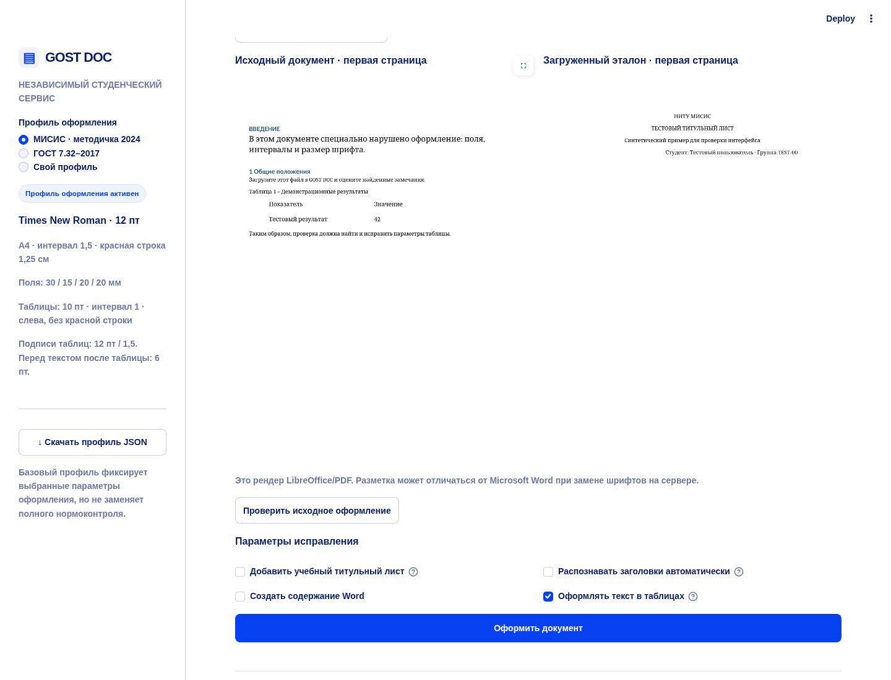
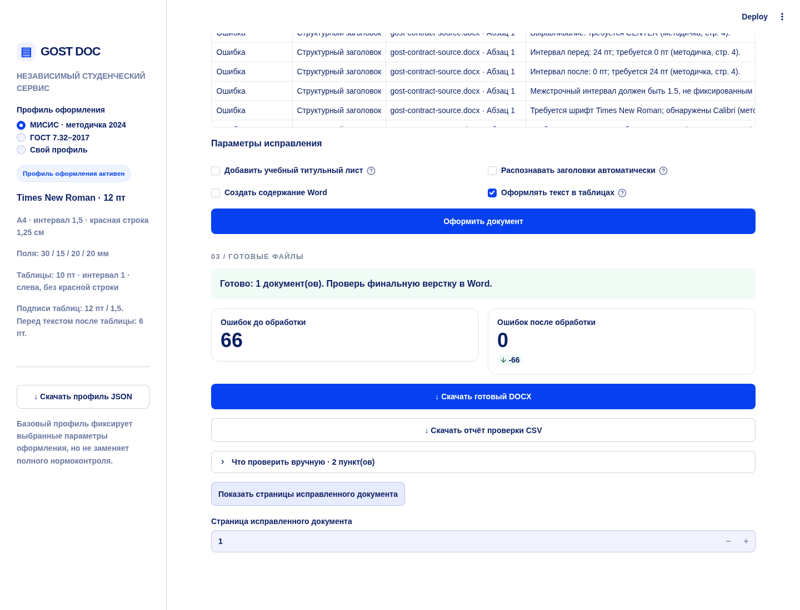

# Проверка GOST DOC: контракт по методичке и сравнение страниц

Проверено 20.11.2026 на Python 3.12.14, Streamlit 1.67.0, python-docx 1.2.0.
Критерии и контрольная сумма исходного PDF находятся в `gostdoc/misis_2024.json`;
инструкция разработчику/сайту — [IMPLEMENTATION_CONTRACT.md](IMPLEMENTATION_CONTRACT.md).

## Автоматические проверки

- `python -m pytest -q` — **50 passed**, включая настоящий рендер LibreOffice.
- `python -m compileall -q app.py gostdoc` — успешно.
- `git diff --check` — успешно.
- Streamlit запускается, `/_stcore/health` возвращает `ok`.
- В CI устанавливается LibreOffice Writer: интеграционные проверки рендера не подменены макетами.

Регрессии повторно открывают DOCX и проверяют таблицы, подписи, интервалы заголовков,
стили содержания 1–9, наследование и все текстовые фрагменты, включая гиперссылки.
Проверяются таблицы-макеты формул, защита титула, поля DATE/PAGE, превращение согласованных
номеров в настоящую нумерацию Word и сохранение текстовых ссылок на разделы.
Номера также проверены в тексте настоящего PDF, сформированного LibreOffice.

`assert_preserved` блокирует выдачу при потере текста, формул, изображений, ссылок,
полей или структуры таблиц. Тесты с намеренной потерей данных подтверждают блокировку.
Разрешённые изменения ограничены форматированием служебных заголовков/тире и переносом
проверенных номеров в счётчики Word. Ни тема, ни результаты, ни ФИО не заменяются.

## Браузерная проверка трёх этапов

Chromium/Playwright с настоящим Streamlit-сервером и синтетическими DOCX:

1. Загружена работа, введено собственное имя `Student_TEST_Lab№1.docx`.
2. Загружен отдельный синтетический титульный эталон; оба файла действительно
   преобразованы LibreOffice → PDF → PNG. Слева показан исходник, справа эталон.
3. Выполнены аудит и исправление; скачанный браузером файл получил **точно заданное имя**.
   Построены и показаны настоящие страницы результата.
4. Режим «Только проверить» формирует отчёт, не предлагает исправленный DOCX.
5. Вычисленный браузером `font-family` содержит Helvetica, `font-weight` равен 700.
   В отсутствие Helvetica клиент использует объявленные системные fallback.
6. Ошибок JavaScript и исключений Streamlit не обнаружено. Проверен мобильный экран 390 px.

Скриншоты ниже — работающий сайт и настоящий рендер, не AI-макет Word.
Персональные документы пользователя в тестах/репозитории не используются.

## Непроверенное и ограничения

- Предоставленный пользователем личный эталон из Drive пока недоступен подключённому
  аккаунту (API 404, веб-ссылка требует входа). Сравнение именно с ним и точное совпадение
  его титульника **не подтверждены**. Его URL и личные данные не публикуются в Git.
- PDF-рендерер здесь — **LibreOffice 26.8.3**, не Microsoft Word. Отсутствующие на сервере
  гарнитуры могут заменяться и менять переносы. Финальное открытие в Word обязательно.
- Автоматические границы страниц, 25% пустого места, смысл цели/выводов/шапки, библиография,
  правильность формул и назначения перекрёстных ссылок остаются визуальными/ручными критериями.
- При неясной иерархии/пропусках нумерация не переписывается, остаётся ошибка/замечание.
- Титульный эталон — источник сравнения; чужие ФИО, тема и данные не копируются в работу.
- Сложные условные стили Word, SDT/Rich Text и таблицы-макеты требуют отдельной сверки.

Проверка не является балльной оценкой: PDF не задаёт шкалу. Ноль найденных технических
ошибок не означает, что все визуальные и содержательные критерии проверены.
