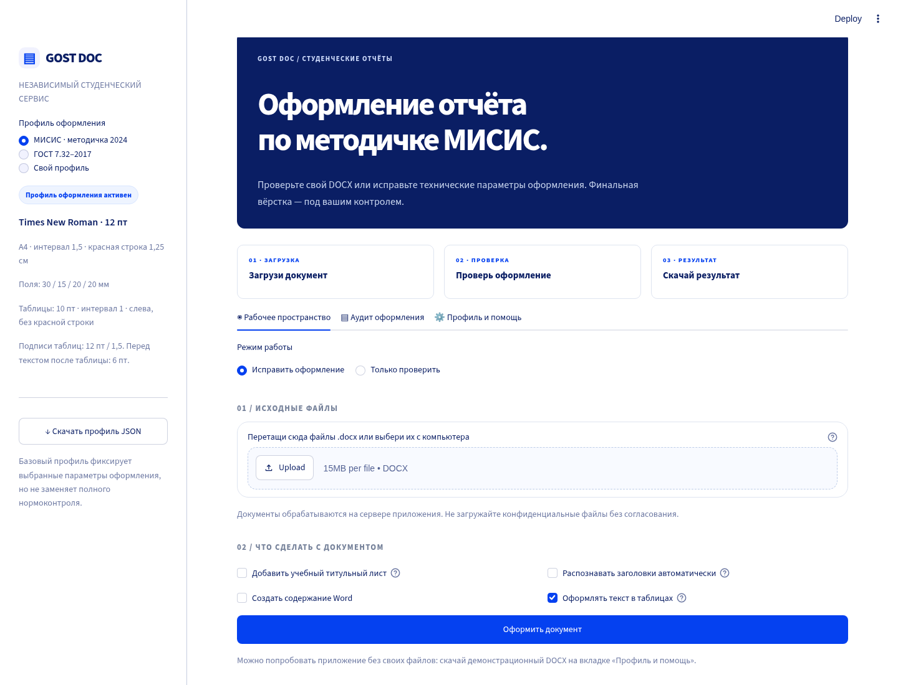
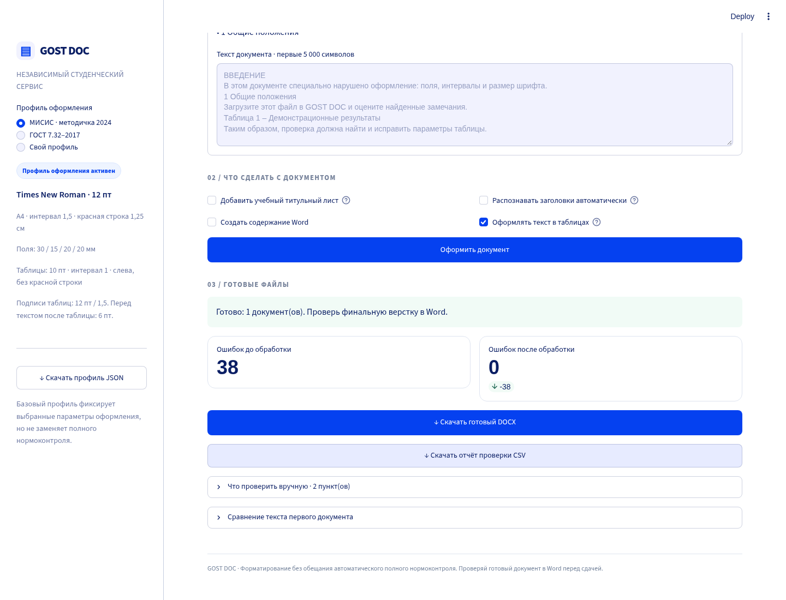
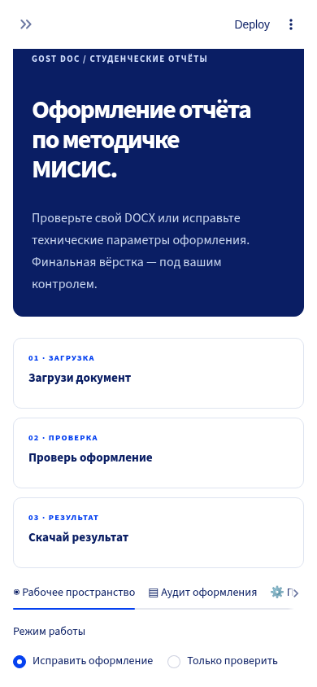

# Проверка поставки: таблицы МИСИС и аудит

Дата: 20.11.2026. Исходная `main`: `8f920e2bef06a0ceb41030f1252141643e1dce7e`.
Оригинальные пользовательские документы и PDF в репозиторий не включены.
Примеры DOCX в тестах генерируются из синтетического текста.

## Автоматические проверки

- До правок: 15 тестов pytest пройдены.
- После правок: `python -m pytest -q` — 29 тестов пройдены.
- `python -m compileall -q app.py gostdoc` — успешно.
- `git diff --check` — успешно.
- Запуск `streamlit run app.py --server.headless=true`: HTTP `/_stcore/health` возвращает `ok`.
- Python 3.12.14, python-docx 1.2.0, Streamlit 1.67.0.

Регрессионные тесты повторно открывают DOCX и проверяют размер/тип шрифта,
выравнивание, отступы, интервалы, процентную ширину, заливку, подпись и текст после
таблицы. Есть вложенные/объединённые/пустые ячейки, второй текстовый фрагмент,
символьный/абзацный стиль, гиперссылки, переопределение шрифта темой и фиксированный
межстрочный интервал. Отдельно проверяются старые JSON, свои параметры и отказ от
форматирования таблиц.

Тест сохранности проверяет изображения побайтно, нативную формулу, сноску с отдельной
частью пакета, закладки, ссылку, поле Word, стиль списка, секции и колонтитулы.
Это проверка структуры DOCX, **не визуальный рендер страниц**.

## Проверка работающего приложения в Chromium

Playwright с настоящим локальным Streamlit-сервером:

1. Загрузка демонстрационного DOCX с намеренными ошибками.
2. Режим «Только проверить» → отчёт на экране и скачивание CSV; кнопки скачивания
   исправленного DOCX в этом режиме нет.
3. Переключение на «Исправить оформление» → обработка → скачивание DOCX и CSV.
4. Повторное открытие именно скачанного браузером DOCX: таблицы 10 пт / интервал 1,
   технических ошибок таблиц не осталось.
5. Переключение на вкладку аудита исходника и обратно.
6. Проверка ширины 1440 и 390 пикселей; на мобильном боковая панель изначально
   свёрнута и открывается штатной кнопкой Streamlit. Ошибок JavaScript не обнаружено.

На демонстрационном документе: **38 технических ошибок → 0**, из них ошибки таблиц
**31 → 0**; три пункта ручной проверки остаются в отчёте. Эти числа описывают только
этот синтетический пример, а не гарантию для произвольного документа.

## Скриншоты

Это снимки работающего Streamlit-приложения, а не макета Superdesign.

Дизайн-макет:
https://p.superdesign.dev/draft/3f718029-c62b-41d9-8053-5b82da972b68

## Ограничения

Word/LibreOffice-рендер страниц не выполнялся. Переносы, реальная ширина сложных
таблиц, смысл шапки, продолжения, таблицы-макеты, точный кафедральный титул,
контекстные интервалы и автоматическая нумерация заголовков, содержание, формулы,
источники и перекрёстные ссылки требуют отдельного этапа и просмотра в Word.
Условные стили Word могут потребовать ручной проверки. Нельзя считать отсутствие
технических ошибок полным нормоконтролем.

При подготовке PR сайт не публиковался, `main` не объединялась автоматически.
